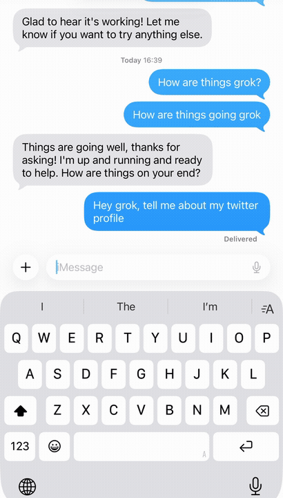

# Photon iMessage Relay

Text a Photon-managed number and get an answer in the same iMessage thread. A local TypeScript relay connects Photon Spectrum Cloud to the agent you choose.

## Choose a tutorial

| Tutorial | Where the answer comes from | What you need |
| --- | --- | --- |
| [Grok Bot](docs/grok-bot.md) | Your existing hosted Grok Bot. The relay starts a webhook routine and receives the answer through an MCP callback. | Grok Bot and an HTTPS callback tunnel. |
| [LangChain + Ollama](docs/langchain-ollama.md) | A LangChain agent in the relay calls Qwen 3.5 9B through Ollama on your Mac. | Ollama and the downloaded model. No public callback tunnel or model API key. |

Both tutorials use [Photon Stable](docs/photon-setup.md) for the iPhone test. Start with capture mode to verify your chosen backend from the terminal before connecting Photon.

## Switch from Messages

Configure both tutorials, then start one process with `RELAY_BACKEND=both RELAY_MODE=imessage npm start`. Text a command on its own line:

| Command | What it does |
| --- | --- |
| `/grok` | Switch to the hosted Grok Bot. |
| `/ollama` | Switch to the local Ollama model. |
| `/backend` | Show the active backend and its setup status. |
| `/reset` | Clear this thread’s relay history for the active backend. |
| `/help` | List the commands. |

The relay handles any message that starts with a slash. Unknown commands get a prompt to text `/help`. The selection survives a restart. Each backend gets its own relay history, and a turn already queued keeps its original backend. [Routing and history details](docs/runtime-behavior.md#backend-switching)

## How the relay works

1. **Receive.** Photon delivers the incoming text over the Spectrum SDK stream.
2. **Respond.** The relay accepts direct texts from your test sender and passes recent turns from that thread to the selected backend. Both paths show iMessage typing while the relay waits for an answer.
3. **Deliver.** The relay sends the answer back through Photon to the originating conversation. Fastify serves health checks, and the relay writes operational events to a local log.

For a code walkthrough, see the [architecture](docs/architecture.md). For request states, retries, and troubleshooting, see [runtime behavior](docs/runtime-behavior.md).

## Grok Bot demo

The clip shows the Grok Bot path. [See both recordings](docs/grok-bot.md#recordings).
