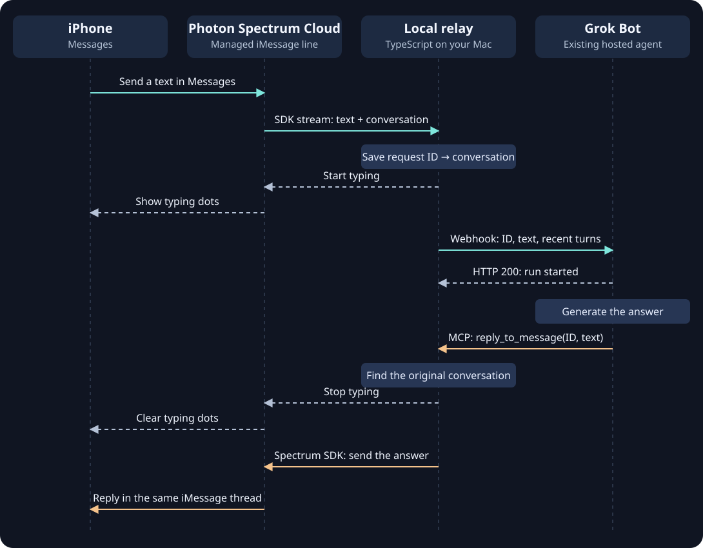

# Relay architecture

The relay gives an existing Grok Bot an iMessage interface. It runs as a single Node.js process. Photon handles iMessage transport, Grok Bot generates answers, and the local relay connects the two.

## Code map

| File | Responsibility |
| --- | --- |
| [main.ts](../main.ts) | Loads configuration, starts the Fastify server, sends Grok routine requests, and selects capture or iMessage input. |
| [relay.ts](../relay.ts) | Queues turns, deduplicates events, tracks requests in SQLite, keeps recent conversation history, and routes replies. |
| [mcp.ts](../mcp.ts) | Defines the Fastify routes, checks callback authentication, and passes protocol handling and tool arguments to the MCP SDK. |
| [relay.test.ts](../relay.test.ts) | Exercises correlation, expiration, ambiguous sends, duplicate suppression, queue order, and history. |
| [mcp.test.ts](../mcp.test.ts) | Uses a real MCP client against the local HTTP server to check authentication, discovery, and tool invocation. Also checks health and readiness status codes. |

## Trace one turn

1. **Receive.** In iMessage mode, `main.ts` reads the Spectrum SDK stream. It accepts inbound, nonblank direct texts from the configured test sender. In capture mode, a line of terminal input becomes a synthetic event.
2. **Queue.** `Relay.receive()` inserts the inbound event ID and a new request UUID. The entry also records the chat ID. For iMessage, the in-memory job keeps a send function bound to the originating Spectrum conversation.
3. **Trigger.** The active job sends Grok Bot `{ requestId, text, history? }` through its routine webhook. A `200` response confirms the run started. It contains no answer text.
4. **Receive the answer.** Grok Bot calls `reply_to_message({ requestId, text })` over MCP. The tool accepts a UUID and trimmed text of 1–8,000 characters. The request ID identifies the active job.
5. **Deliver.** Capture mode saves the answer in SQLite. iMessage mode uses the existing Spectrum conversation to send it. A successful capture or send updates conversation history before the next queued turn starts.

## Credentials and data

- The Photon project ID and secret are used by the Spectrum SDK in iMessage mode.
- The Grok routine bearer key authorizes the outgoing webhook. The separate MCP bearer secret authorizes the incoming callback.
- Only the callback listener needs to be reachable from Grok Bot. It binds to loopback, and the tutorial uses an HTTPS tunnel to reach it.
- The sender and conversation identifiers stay in the relay. The current message and up to four recent exchanges go to Grok Bot. Routine status logs contain a request UUID, state, and timestamp. The SQLite database contains chat IDs and capture-mode answer text.

## Fastify and process lifecycle

Fastify owns HTTP routing and server shutdown. Its `/mcp` route checks the bearer token before parsing JSON, then passes the parsed body and raw response to the MCP SDK. The SDK handles the handshake and tool calls. The Spectrum listener and relay queue run in the same process.

`GET /healthz` reports that the HTTP process responds. `GET /readyz` returns `503` while input is starting and `200` once capture input or the Spectrum provider has initialized. Readiness does not probe Photon delivery or confirm that Grok can reach the tunnel. Both endpoints return only a status string.

On SIGINT or SIGTERM the process marks itself unready and closes the HTTP server and input source. A restart preserves the request status database and clears conversation history.

See [runtime behavior](runtime-behavior.md) for failure states and verification.
