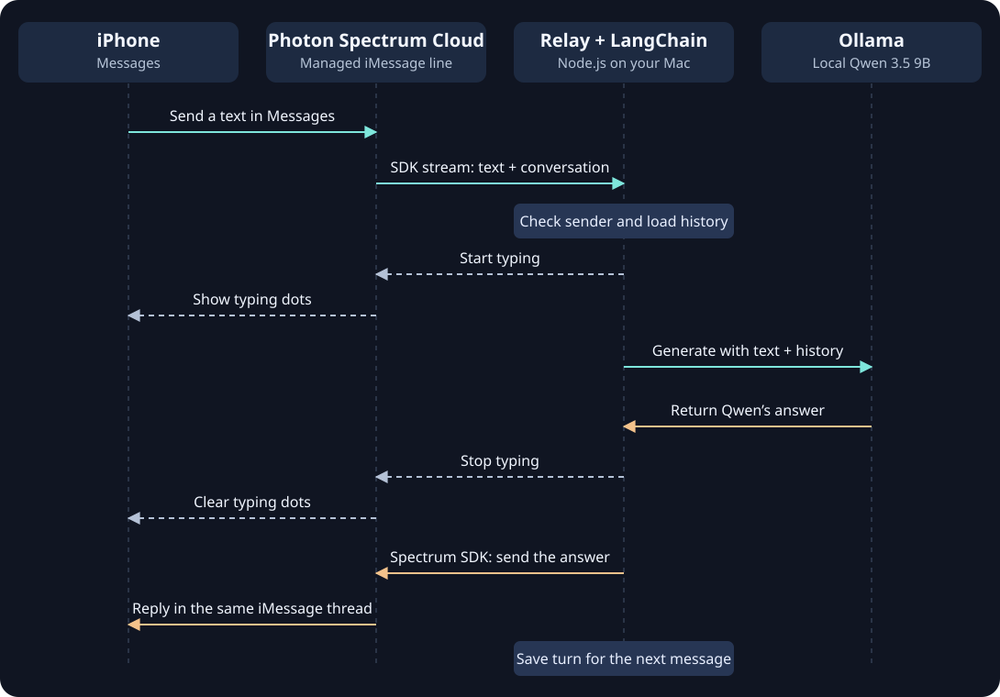

# Text a local LangChain agent with Photon

This walkthrough uses `qwen3.5:9b` on a Mac through Ollama. LangChain runs inside the relay and sends the model only the current message and recent context. Photon still transports the iMessages.



LangChain runs inside the relay process. It waits for Ollama’s answer on the local connection before the relay replies through Photon.

## 1. Start the model

Install [Ollama](https://ollama.com/download) if needed. Leave the server running and pull the model from another terminal. The downloaded model occupied about 6.6 GB in the tested setup.

```sh
ollama serve
# In a second terminal:
ollama pull qwen3.5:9b
```

## 2. Verify two turns locally

Use Node.js 26 and npm. Create a private `.env` once. Keep an existing `.env` if you've already configured the relay.

```sh
git clone https://github.com/BrianSeong99/photon-imessage-relay.git
cd photon-imessage-relay
npm ci
npm run check
npm test
(umask 077; test -e .env || cp .env.example .env)
RELAY_BACKEND=ollama RELAY_MODE=capture npm start
```

Type **Give me two three-word names for a coffee shop.** Wait for `captured`, then type **Make the second one shorter.** Inspect the answers from another terminal in the repo. The second should shorten the second name from the first reply.

```sh
sqlite3 -readonly relay.sqlite 'SELECT status, captured_text FROM turns ORDER BY rowid DESC LIMIT 2;'
```

Capture mode saves its answers to the local SQLite file. Use synthetic prompts for this test. If you changed `RELAY_DB`, query that file instead.

## 3. Text your agent

Stop capture mode with Ctrl+C. Follow the [Photon Stable setup](photon-setup.md) to configure `PHOTON_PROJECT_ID`, `PHOTON_PROJECT_SECRET`, and `TEST_SENDER` in `.env`. Keep Ollama running, and run only one relay process on the test line.

```sh
RELAY_BACKEND=ollama RELAY_MODE=imessage npm start
```

Wait for `photon_ready`, then text the assigned Photon number from the registered sender. Ask the same follow-up in the thread. Spectrum starts the typing indicator around generation and clears it when the call settles. The first reply can take longer if Ollama needs to load the model. Your Mac needs to stay awake to answer.

Ollama mode needs no Grok Bot credentials, model API key, or public callback tunnel. Set `OLLAMA_MODEL` to select another installed Ollama model. The default is `qwen3.5:9b`.

## Monitor the relay

```sh
tail -f relay.log
curl -fsS http://127.0.0.1:8787/readyz
ollama ps
```

The log appends JSON lines with UTC timestamps, backend, model, request ID, and state. Match `generation_started`, `generation_finished`, and `sent` by ID. Generation duration is in milliseconds. Message text and credentials are excluded from the operational log. Set `RELAY_LOG_FILE` to change the file location. The readiness endpoint indicates service startup status. Watch Messages to confirm delivery.

If startup says the model is unavailable, check `ollama list` and pull the configured model. If generation fails, check Ollama’s console and the relay's `generation_failed` event. Restarting the relay clears conversation history.

[LangChain ChatOllama integration](https://docs.langchain.com/oss/javascript/integrations/chat/ollama) · [Qwen 3.5 9B](https://ollama.com/library/qwen3.5:9b)
